 

## 👋 About

I'm a software engineer working with AI. I enjoy experimenting with different approaches to see what works best, and finding ways to make software **faster, lighter, and easier to maintain**.

I follow the Unix philosophy when writing code: keep things simple, and make each part do one thing well.

### 🔭 Right now

- 🧠 **AI Engineer at [Netcompany](https://netcompany.com)** — LLM applications, retrieval systems and evaluation
- 🌬️ **Building [Anemos](https://github.com/NickLitharis/anemos)** — an operating system with an independently implemented kernel

## 💼 Experience

<table>
  <tr>
    <td width="28%" valign="top"><b>AI Engineer</b> · <a href="https://netcompany.com">Netcompany</a> Nov 2025 – Present</td>
    <td valign="top">Building AI applications around LLMs, retrieval and evaluation: testing answer quality, checking citations, building document-processing pipelines, and improving how AI systems handle information.</td>
  </tr>
  <tr>
    <td width="28%" valign="top"><b>AI Intern</b> · Prosperty Feb 2024 – Mar 2024</td>
    <td valign="top">Worked on an API that uses LLMs to generate property descriptions from structured data, cutting the time to produce them <b>from hours to seconds</b>.</td>
  </tr>
</table>

## 🚀 Projects

<table>
  <tr>
    <td width="50%" valign="top">
      <h3><a href="https://github.com/NickLitharis/medica">🩺 Medica</a></h3>
      
My BSc thesis: medical image captioning with a CNN encoder and an attention-based RNN decoder in TensorFlow, evaluated on ImageCLEF 2017. Since modernised and re-scored like-for-like against the original model.

      
      
      
    </td>
    <td width="50%" valign="top">
      <h3><a href="https://github.com/NickLitharis/groundwork">🧱 Groundwork</a></h3>
      
Twenty-four model-agnostic skills that give coding agents book-grounded engineering principles, from planning and debugging to security and modularity.

      
    </td>
  </tr>
  <tr>
    <td width="50%" valign="top">
      <h3><a href="https://github.com/NickLitharis/anemos">🌬️ Anemos</a></h3>
      
An open-source operating system with an independently implemented kernel, judged by how closely it matches Windows XP's observable behavior. It boots its own C23 x86_64 kernel in QEMU with exceptions, a timer, page allocation and a kernel heap; scheduling and user-mode execution are still to come.

      
      
      
    </td>
    <td width="50%" valign="top">
      <h3><a href="https://github.com/NickLitharis/tooldelegate">🔬 Tooldelegate</a></h3>
      
A Rust benchmark that tests whether a language model uses fewer tokens, and gets more artifacts right, when it delegates deterministic transformations to sandboxed tools instead of generating the result itself. Every run is scored by an independent hidden oracle, and no approach is presumed better. In the v3 cohort delegation won on correctness (70–74% success vs 17% direct) but token savings were not established, and its CLI arms allowed Python. Next: a planned CLI-vs-MCP comparison, not yet built.

      
      
    </td>
  </tr>
</table>

## 🛠️ Toolbox

<table>
  <tr>
    <td width="50%" valign="top">
      <h3>💻 Languages</h3>
      
      
      
      
      
      
      
    </td>
    <td width="50%" valign="top">
      <h3>🔎 AI &amp; Retrieval</h3>
      
      
      
      
    </td>
  </tr>
  <tr>
    <td width="50%" valign="top">
      <h3>⚙️ Infrastructure</h3>
      
      
      
    </td>
    <td width="50%" valign="top">
      <h3>🤖 AI-Assisted Development</h3>
      
      
      
      
      
      
      
    </td>
  </tr>
</table>

## 🎓 Education

**BSc in Computer Science** — [Ionian University](https://ionio.gr) · Oct 2019 – Jun 2024

 

> *Διά των δύο οδών συντομοτέρα η ευθεία* 
> Of the two roads, the straight one is shorter.

